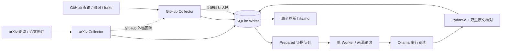
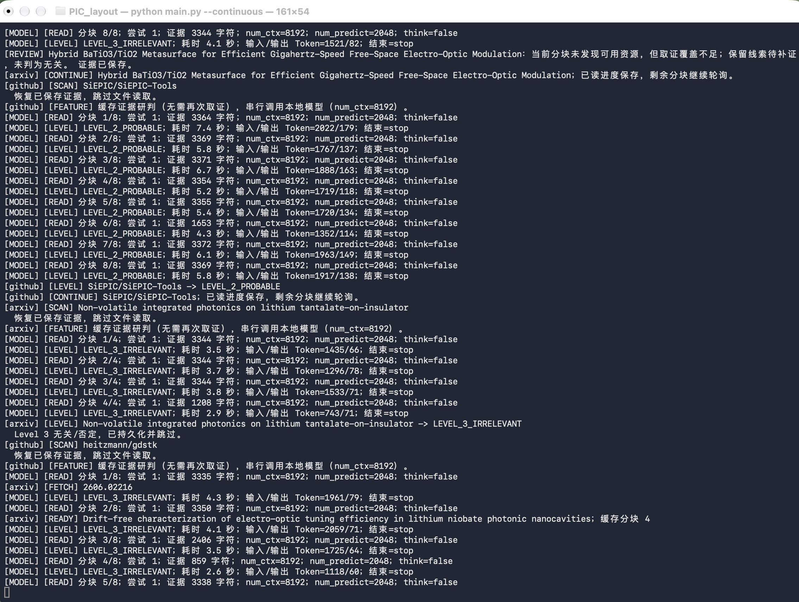
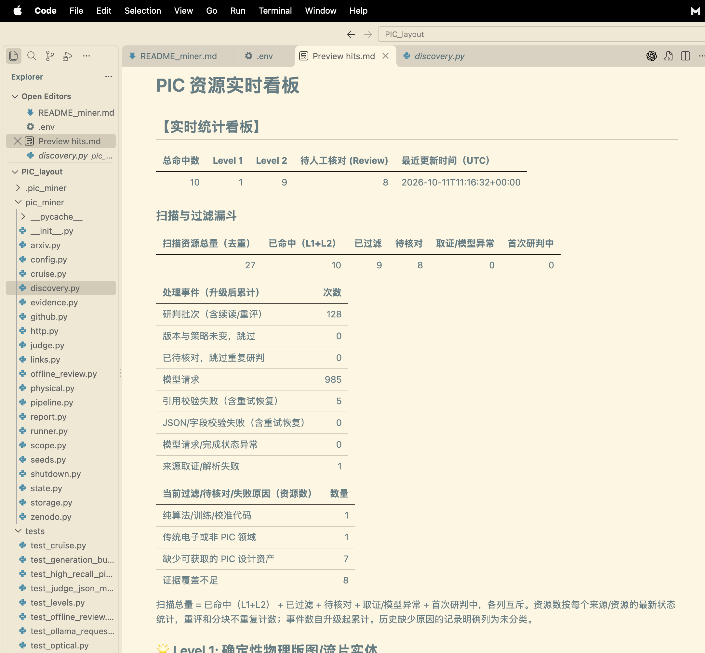
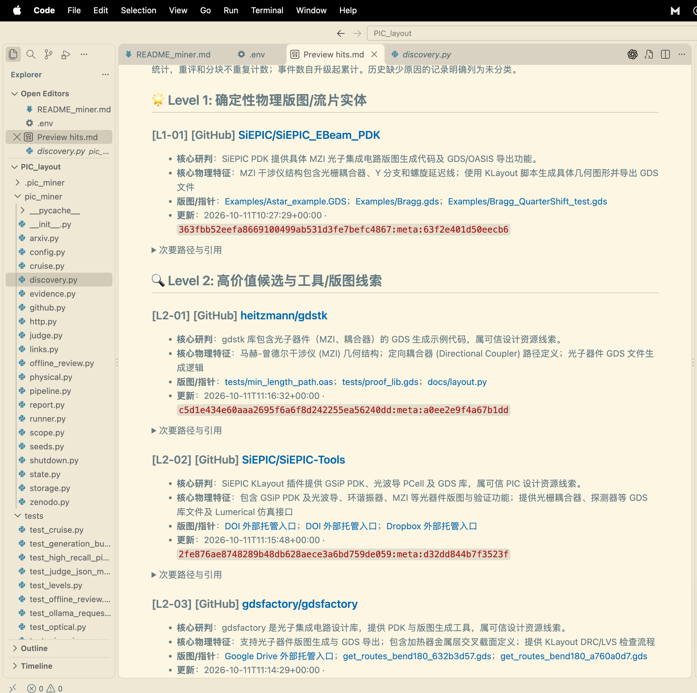

# PIC Layout Miner

**面向光子集成电路物理设计自动化的资源发现、证据研判与持续监控系统。**

PIC Layout Miner 从 GitHub 开源生态与 arXiv 学术公开材料中发现可能可复用的 PIC 版图、PDK、参数化器件与生成脚本，使用局域网 Ollama 模型进行有证据约束的语义初筛，并在本地维护可审计、可恢复的资产看板。项目的研究目标是为 **PIC metal-routing benchmark** 建设提供持续更新的候选资源池，尤其关注有源器件、电极、加热器、焊盘、金属互连与具备规模或制造背景的电路。

系统采用宽入口、严证据的策略：规则负责定位阅读重点，模型负责理解项目语境，Python 负责结构与引用校验，人工负责最终的版图与基准适用性确认。当前交付的是资产发现基础设施；几何验证、工艺规则检查与 benchmark 标准化属于后续独立环节。

| 项目属性 | 当前实现 |
|---|---|
| 活跃发现来源 | GitHub、arXiv；Zenodo 适配器保留，采集暂时停用 |
| 执行模式 | 默认持续巡航；支持有界单轮与免爬取重评 |
| 推理方式 | Ollama HTTP API，单 Worker、单并发、原生 JSON 模式 |
| 研判结果 | `LEVEL_1_CONFIRMED` / `LEVEL_2_PROBABLE` / `LEVEL_3_IRRELEVANT` |
| 持久化 | SQLite、WAL、事务化任务与游标、按内容哈希保存证据 |
| 人工入口 | 本地 `hits.md`：互斥状态漏斗、Level 1/2 分区、Review 附录 |
| 验证 | 302 项单元测试，使用临时数据库与模拟远端服务 |

## 目录

- [研究背景与目标](#研究背景与目标)
- [资产分类与判定边界](#资产分类与判定边界)
- [系统架构与调度](#系统架构与调度)
- [多源发现与版本化取证](#多源发现与版本化取证)
- [模型阅读与严格校验](#模型阅读与严格校验)
- [持久化、容错与恢复](#持久化容错与恢复)
- [看板与过滤漏斗](#看板与过滤漏斗)
- [安装与使用](#安装与使用)
- [配置参考](#配置参考)
- [项目结构与测试](#项目结构与测试)
- [从候选池到路由基准](#从候选池到路由基准)
- [能力边界与后续工作](#能力边界与后续工作)
- [凭证、数据与版本管理](#凭证数据与版本管理)
- [参考资料](#参考资料)

## 研究背景与目标

### PIC PDA 的数据需求

光子集成电路的物理设计需要同时处理光学连接与电气控制。波导连接关注端口方向、截面连续性与弯曲几何；有源电路还需要把相移器、调制器、探测器或加热器的电气端子连接到金属网络与封装焊盘。相关设计流程通常还涉及层次化器件、工艺层映射以及 DRC/LVS 等验证环节。[硅光电路设计综述](https://www.photonics.intec.ugent.be/download/pub_4023.pdf)讨论了这些设计与验证要素；[GDSFactory 路由文档](https://gdsfactory.github.io/gdsfactory/notebooks/04_routing/)提供了端口与成组路由的工程实例。

针对 PIC 的金属路由研究，需要的是能够明确器件位置、端口、障碍物和层规则的物理设计实例。随机生成的网格、纯电子 ASIC 设计或只含波导的微型演示，可能有助于验证算法，却难以覆盖有源 PIC 的端口分布、器件周边禁布区、pad 扇出和光电共存等问题。因此，本项目把真实设计资源的发现作为基准构建的前置工作。

### 为什么资源发现不能只靠扩展名搜索

公开资源往往分散在工具仓库的示例目录、研究团队的下游项目、fork、Releases 附件、论文的数据可用性声明与外部托管链接中。一个仓库没有根目录 GDS，不代表没有布局生成代码；一个 `.gds` 文件也不一定是 PIC 设计：通用解析引擎可以用矩形测试写出 GDS，光计算算法可以用 heater、phase、modulator 等词描述张量参数，论文可以报告已制造器件却不公开设计文件。

这带来三个相互关联的挑战：

1. **发现覆盖**：名称、材料平台、语言和资源托管方式不同，单组关键词容易漏检。
2. **语义辨别**：需要区分具体 PIC 设计资产、可用工具线索和只有领域术语的项目。
3. **可复核性**：结论必须回到具体版本、文件路径与原文，而非模型给出的连续“置信度”。

本项目不依赖不可校准的浮点概率门槛，而是使用三档证据等级与独立的 Review 状态，把资源价值判断和处理失败分开表达。

### 面向研究的工作流

```text
公开资源发现 → 静态证据缓存 → 三档语义研判 → 人工确认
                                              ↓
                         获取实体与核验许可 → 几何/端口提取 → benchmark 构建
```

本仓库实现前三个自动化环节及人工确认入口。后半段是建议的数据建设流程，不是已经实现的自动路由或版图验证功能。

## 资产分类与判定边界

### 三档制：以设计资产证据代替概率幻觉

| 模型等级 | 所表达的结论 | 典型证据 | 系统处理 |
|---|---|---|---|
| `LEVEL_1_CONFIRMED` | 直接发现具体 PIC 物理设计资源 | 具体光子器件/电路几何，与实际物理文件或导出相互支持；有效的 PIC LFS 实体线索 | 保存当前命中卡片，置于 Level 1 |
| `LEVEL_2_PROBABLE` | 有价值、仍需核实的 PIC 设计线索 | PIC PDK、版图生成器件/工具、真实光子几何教学示例、可信开放设计声明或外部入口 | 保存候选卡片，置于 Level 2 |
| `LEVEL_3_IRRELEVANT` | 当前材料不构成目标设计资产 | 纯传统电子项目、底层解析测试、张量训练/校准、没有开放设计资源的理论或实验工作 | 持久化终态与原因，不写命中卡片 |

`CONFIRMED` 表示存在直接的资源证据，不等于通过 foundry sign-off，也不等于已经证明工业规模、电极连通性或可用于再分发。即使有明确 PIC 版图，仍需要人工检查它是否满足目标 metal-routing benchmark 的有源器件、金属网络和规模要求。

### 光子领域特异性与反例约束

System Prompt 首行明确限定 PIC。传统 Electronic IC、Analog/Digital ASIC、VLSI、PCB 即使包含 GDS/OAS、端口和路由，也不能凭这些通用特征进入 Level 1/2。

实现进一步通过 `scope.py` 区分工具能力与具体资产：

- **底层解析器**：`gdstk/gdspy` 的原生测试导出不能证明真实 PIC 实体；如果文档确实包含 MZI、耦合器等光子几何示例，可以保留为 Level 2 工具线索，不能升为 Level 1。
- **光计算算法**：仅有 PyTorch 训练、矩阵仿真、校准或 heater/phase 参数，不能被视为器件几何和金属布局。
- **混合仓库**：使用 PyTorch 或底层几何库不是否定条件；若同一项目包含真实 PIC 几何、PDK 或设计代码，仍需保留。
- **不完整取证**：静态约束的完整性判断是保守的，不能因为尚未读取到具体资产就排除整个大仓。

规则匹配没有成为所有资源的词表准入门槛。中文描述、TFLN/Pockels 等平台术语和源代码定义均可提供语义证据。模型仍参与阅读，领域与资产约束在本地校验后继续约束最终裁决。

### Review 是处理状态，不是第四个等级

Review 用于表达结论尚不能安全结算，典型原因包括：

- 已读窗口未发现资源，但仍有未读材料或取证采样缺口；
- 两次已完成的生成仍未通过 JSON、字段或原文引用校验；
- 旧记录缺少足以支持重新裁决的证据。

负向裁决在覆盖不足时会保留为 Review，避免把“没有看到”当成“不存在”。已验证的正向线索不会因为后续某个窗口输出失效就被抹掉。模型请求状态不明、取证失败等异常另有错误状态与事件记录。

## 系统架构与调度

### 轻量、分离的三条执行通道

系统使用 Python 标准库线程、`requests`、Pydantic 与 SQLite，不依赖分布式消息队列或重型爬虫框架。默认入口为 `main.py → PipelineCruise`。



GitHub 与 arXiv 分别有独立采集线程。网络发现与静态取证可以在模型读取当前资源时继续进行；所有数据库操作通过专用 `StateWriter` 线程执行，SQLite 连接不会跨线程直接共享。主 Worker 只消费已准备好的证据，避免推理通道被同步抓取拖住。

### 两层公平轮转与背压

**采集层**在到期查询之间轮转，每次只推进一页或一次历史窗口拆分。一个查询搜索结束只改变自己的游标，不让整个来源长时间休眠。采集器还交替推进发现和已有任务：当证据缓存为空时，每处理两个任务给发现一次机会；已有缓存时量子为四个任务，防止未变更仓库的复查占满供料时间。

**消费层**在 GitHub 与 arXiv 的 prepared 队列间 Round-Robin，空来源自动跳过，轮转位置持久化。一个大仓每批只读 `MODEL_CHUNKS` 个新窗口；存在有效阅读进度且材料未读完时，它回到队列，给其他来源机会。

每个来源的 prepared 数量受 `PREFETCH_PER_SOURCE` 限制。缓存满时只暂停该来源预取，Worker 消费后恢复。这限制的是就绪条目数量，不是数据库的长期保留总量；持续运行仍需要管理磁盘容量。

### 串行推理与运行实证

下面的运行日志展示了分块串行生成、输入/输出 Token 统计、结果结算、从缓存恢复证据以及 GitHub/arXiv 交替推进。`[CONTINUE]` 表示有效阅读进度已保存、剩余窗口重新轮询；它不是把校验失败的同一窗口无限重试。对已确认完成的非法输出，系统才进行一次有界降级重试。



*图 1：实际巡航日志。截图中的单次耗时说明该次运行的行为，不构成硬件无关的吞吐基准或长期 GPU 利用率保证。*

模型 Worker 有进程内锁，工程还使用 `.pic_miner/run.lock` 拒绝同目录重复启动。它们限制本工程的模型并发；若其他客户端也访问同一 Ollama 主机，需由部署方协调总负载。只要有就绪任务，Worker 持续推进；API 限流、网络故障、缓存为空与模型暂停仍会产生合理等待。

**Zenodo 当前状态**：适配器、查询配置、任务和历史证据保留，但默认不启动 Zenodo 采集线程，也不消费该来源任务。新发现的 Zenodo 链接可以先入队等待恢复。`--zenodo-query` 只增加配置，不会绕过暂停开关。恢复需要在代码中的启用来源集合重新加入 `zenodo`，或显式构造包含三路来源的调度器；无需删除数据库。

## 多源发现与版本化取证

### GitHub：搜索覆盖与拓扑扩散

发现入口包括组织仓库、显式仓库、拓扑种子的 forks、README 引用项目与全网 repository search。`seeds.json` 支持平铺查询和分组查询，归一化后去重、交错展开。当前种子配置含 16 个组织、24 个拓扑仓库、131 条 GitHub 查询与 24 条 arXiv 查询，覆盖器件、电极、PDK、路由、流片、开放数据、材料平台和中文线索。

搜索采用更新时间排序，并将 **created 历史窗口** 与 **pushed 增量窗口** 分离保存。遇到超过 GitHub Search 可访问结果范围的窗口，按时间二分后继续分页。历史通道覆盖完成后停用该历史游标，增量通道持续跟进；不会反复从历史起点重扫。搜索入队与游标提交同事务，页码不会先前移再丢任务。

搜索覆盖受公开 API 索引、查询语义和平台可访问性约束，“地毯式”描述的是多入口、持续探索的策略，不是全互联网完备性证明。[GitHub Search API 官方文档](https://docs.github.com/en/rest/search/search)说明了搜索分页与结果范围等约束。

### 固定 HEAD、Releases 与外部实体线索

`github.py` 取得真实默认分支 commit SHA，读取该版本的文件树与 blob；递归树截断时补读子树。版本身份还包含 Release 附件与仓库元数据指纹，因此代码 HEAD 不变但附件或描述发生实质变化时，仍可以触发新的分析。

静态取证综合以下材料：

| 材料 | 提取方式与价值 | 边界 |
|---|---|---|
| Markdown/RST | 多级文档读取，版图、PDK、端口、电极相关段落优先，代表切片不超过 3,000 字符 | 采样最多 16 个文档；未读材料标记覆盖不足 |
| 源码/Notebook | 导出调用、器件定义、端口与顶层连接；源码不要求先命中正则才保存 | 最多 40 个源码；单文件最多 8 MiB；不执行代码 |
| `.gds/.oas` 与相关文件 | 路径、文件大小、小文件头部识别与版本化入口 | 不进行完整几何解析或 DRC |
| Releases | 分页取得附件名称、大小、URL、更新时间及可用摘要信息 | 命名相关的压缩包是线索，不自动展开 |
| Git LFS | `.gitattributes` 追踪规则，标准 pointer 的 OID 与原始 `size` | pointer 存在不等于 LFS 对象已下载或可访问 |
| DOI/OSF/网盘 | 提取托管入口及邻近版图声明 | 一般 DOI 也可能只是论文；必须人工核实内容 |

大 Notebook 先进行结构清洗，只抽取 code cell 的源码，丢弃输出、图像和 base64；其他源码只作静态文本分析。有效 LFS pointer 的原始体积来自 pointer 的 `size`，不会把百余字节的指针误当成 tiny layout。Releases 附件与外部入口进入证据包后仍需符合 PIC 资产语境，不能因文件扩展名自动获得最终等级。

### arXiv：论文到代码资源的穿透

发现使用官方 Atom API，检索光学与微电子相关类目、PIC 设计、tapeout、optical routing 和 thermal crosstalk 等表达式。历史通道按提交日期建立固定窗口，对大结果集按分钟二分、近期优先，再推进旧窗口；增量通道按更新时间跟进新论文与修订。偏移、水位线及未完成窗口持久化。

默认采集不仅保存 Title、Abstract、Comments 和 Atom 链接，还优先提取 HTML 正文；不可用时尝试有界 PDF fallback，静态提取 Data/Code Availability、开放设计声明和外部链接。PDF 有大小、页数与文本量保护。HTML/PDF 无法取得时保留已有元数据并标记取证不足。适配器同时保留轻量 metadata reader 供有界场景使用。

外链回流与正向研判解耦：取证中发现 GitHub/Zenodo 目标就可以建立来源边、入队，不需要等论文先获得 Level 1/2。论文描述了制造器件，不能单独证明版图公开；可获取的代码、PDK、设计附件或可信开放声明才是本项目关注的资源线索。查询语法与分页遵循 [arXiv API 手册](https://info.arxiv.org/help/api/user-manual.html)。

### Zenodo：保留但暂停的扩展来源

`zenodo.py` 已实现 REST 元数据与附件清单读取、有界文本提取和记录 ID 规范化。Zenodo GET 显式允许重定向，但限制次数与来源；记录跳到新 ID 时合并别名，避免旧 ID 反复进入队列。记录级不可恢复的 3xx/4xx（不含 429）连续三次失败后熔断为 `FAILED`；临时 5xx、429 和网络故障走退避，不消耗永久记录熔断计数。上述适配器行为有测试覆盖，但默认巡航目前不发起 Zenodo 采集请求。

## 模型阅读与严格校验

### 原文、预览与窗口分工

SQLite 的 `evidence_blobs` 按 SHA256 保存已取得且经过清洗的完整文档/源码；每个证据块记录稳定 `E` 编号、路径和原文哈希。扫描记录中的 `evidence_json.text` 是最多 10,000 字符的预览，不是新资源唯一保存的材料。模型从缓存原文构造有重叠的窗口，按来源文件分配代表窗口，再继续其他窗口。

导出、电气器件、金属、端口和制造特征影响阅读优先级，有限预算内优先保留关键上下文；窗口保留原文字符与稳定编号。纯路径清单的价值低于实际器件定义、README 摘要和可用性声明。`examined_chunks` 与 `best_assessment` 保存已读进度和已验证最佳结果，使大资源能够在多次公平轮转中逐步覆盖。

### 固定显存边界与生成预算

| 参数 | 当前请求值 / 上限 | 目的 |
|---|---|---|
| `format` | `"json"` | 使用可移植的 Ollama JSON 模式，不发送复杂 Pydantic Schema |
| `stream` | `false` | 收到完整响应后再校验、提交 |
| `think` | `false` | 请求关闭独立思考输出，减少 JSON 生成预算竞争 |
| `options.num_ctx` | `8192` | 显式固定上下文，避免服务器默认窗口意外扩大 |
| `options.temperature` | `0` | 降低采样波动；不能替代事实校验 |
| 首次证据 | ≤3,500 字符 | Python 侧硬预算，不把全仓直接送入模型 |
| 降级重试证据 | ≤1,500 字符；引用失败时进一步缩到 950 字符 | 聚焦原文，给结构化输出留空间 |
| `options.num_predict` | 首次 2,048；已完成但校验失败时 4,096 | 有界输出与自适应修复预算 |
| 模型并发 | 1 | 避免本工程叠加模型请求 |

字符预算针对证据正文；System Prompt 和修复指令额外占用上下文。字符数与 Token 数并非严格换算，实际 Token 与生成统计记录在调用追踪中。固定窗口、单并发和输入预算控制负载，但显存占用还取决于量化、后端、KV cache 与其他客户端，不能仅凭 `num_ctx` 保证所有部署都不 OOM。

`MODEL_KEEP_ALIVE=-1` 会转换成 JSON 数字，保持模型驻留；带单位的 `5m` 等仍作为时长字符串。`num_ctx`、证据上限和生成预算是代码中的保护常量，不是可任意扩大窗口的环境开关。[Ollama Chat API 文档](https://docs.ollama.com/api/chat)提供了 JSON 模式及请求字段的接口说明。

### 四字段输出与双重引文验证

模型输出只允许以下四个字段：

```json
{
  "level": "LEVEL_2_PROBABLE",
  "summary": "提供光子版图生成工具与器件线索，具体设计实例需核实。",
  "physical_features": ["存在光子版图导出语句"],
  "evidence": [{"id": "E7", "quote": "component.write_gds(\"chip.gds\")"}]
}
```

这是结构示例，不对应真实资源。Level 1/2 必须提供具体特征和引用；Level 3 的 Prompt 要求空特征/引用列表，并在摘要开头携带 `LOW_LEVEL_TOOL`、`ALGORITHM_ONLY`、`NON_PIC` 或 `NO_DESIGN_RESOURCE` 原因标签。

本地校验链路为：

1. 清洗代码块包装、解释前缀和可分离的完整 JSON；拒绝重复键、歧义及无法恢复的结构。
2. 原始类型预检，防止字符串/列表等类型错位被隐式转换。
3. Pydantic `Assessment` 严格验证枚举、字段集合、类型、长度与单行约束，拒绝额外字段。
4. 引用必须是实际模型输入中对应 `E` 段正文的逐字子串。
5. 引用还必须存在于保存的同编号原始证据正文；路径标题不能代替正文。
6. 结合 fixture 路径、底层工具及纯算法语境约束最终资产等级。

校验不自动翻译引用、补标点、归一化空白或拼接断开的句子，也不补造 JSON 字段或闭合括号。`done_reason=length` 时，只有已经完整、且通过所有校验的输出才可使用；截断的非法 JSON 进入有界重试。

逐字核对证明的是引用出处可追溯，不证明摘要的每个物理特征都被逻辑蕴含；当前也没有做到逐特征独立引文验证。这是人工核对与后续事实校验需要继续补齐的部分。

### 有界修复与请求状态隔离

每个窗口最多两次已完成生成。首次格式/引用校验失败后，压缩输入并附具体错误与“仅输出纯合法 JSON”指令；引用失败另外提供少量可逐字复制的正文候选，返回内容仍执行同样严格的双重验证。失败超限时保留证据与原因，进入 Review，调度器不立即无限重读同一失败窗口。

模型连接断开、读取超时或 `done != true` 时，服务器可能仍在生成。系统暂停模型通道、不自动重复 POST；采集可继续至缓存上限。用户确认服务端状态、修正问题后重启，恢复 prepared 与已读进度。HTTP 400 等明确拒绝会打印脱敏、限长的服务端错误字段，保存断点等待配置修复。这与“已完成但 JSON 非法”的重试是两类不同情况。

## 持久化、容错与恢复

### 状态与版本身份

资源去重不是全表扫描。SQLite 使用复合主键及 B-tree 索引；单条查找的理论复杂度是 `O(log N)`，不把索引查询错误描述为严格 `O(1)`。

| 表 / 数据结构 | 主要职责 |
|---|---|
| `tasks` / `aliases` | 按 `(source,item_id)` 去重排队，记录规范 ID、到期时间、失败次数与永久熔断 |
| `cursors` / `scheduler_meta` | 搜索页码、水位线、历史窗口栈、来源与查询轮转位置 |
| `prepared` | 已完成取证、可直接推理的资源与证据引用 |
| `scans` | `(source,resource_id,version,pipeline_key)` 下的扫描、证据与裁决历史 |
| `evidence_blobs` | 按内容哈希去重保存原文 |
| `resource_links` | 论文/仓库与外部目标的发现来源边 |
| `model_calls` | 输入字符数、尝试、耗时、Token、生成结束状态、错误分类与有界脱敏输出 |
| `report_items` / `report_meta` | 每个资源的当前看板条目、修订号与发布状态 |
| `resource_outcomes` / `funnel_counters` | 去重资源的互斥当前状态与累计处理事件 |

远端版本相同且研判协议相同的已完成目标，跳过重复取证与模型。确认远端未变更仍需要受频控的版本/附件查询。GitHub 版本不仅含 commit SHA，还含 Releases 与元数据指纹；模型、Prompt、Schema、预算和流程版本参与 `pipeline_key`。协议升级会重新排队旧目标，保留历史裁决并清除不适用的旧阅读进度。

### 事务与报告发布

数据库启用 WAL 与 `synchronous=FULL`。发现页入队和游标前移一起提交；资源结算、当前状态和漏斗计数一起更新。报告发布采用以下顺序：

```text
保存已验证结果与发布修订 → 生成完整新看板 → 临时文件 flush/fsync
                                                ↓
                            原子替换 hits.md → 标记该修订已发布
```

`hits.md` 是数据库导出的可恢复视图。写入失败不会把已提交的模型结论改成失败；下次刷新根据修订/outbox 补写。看板保留生成区外的人工备注，避免用户注释被整文件重建覆盖。

### 来源故障隔离与 API 频控

GitHub 普通请求至少间隔 2.5 秒，搜索节拍单独管理；arXiv API 与正文读取共享至少 3.5 秒节拍。Zenodo 恢复采集后使用其自己的节拍。固定间隔只是基础约束，服务端限流头仍有更高优先级。

GitHub 403/429 分析一级与二级限流，读取 `X-RateLimit-Reset` 和 `Retry-After`，按较晚截止时间等待并打印倒计时；相关等待只占用该来源通道，其他来源与就绪推理继续。临时网络或 5xx 请求有界退避，失败任务与游标保留断点，不跳过尚未成功入队的页。普通来源级错误局部隔离；不可预期的本地/存储异常安全停机，避免采集线程悄悄退出。

公开 API 客户端不跨来源携带 GitHub Token；GitHub/Ollama 禁止自动重定向，Zenodo 只允许受约束跳转。HTTP Session 不继承代理/netrc，避免把局域网模型请求或凭证意外送往环境代理。如果部署必须经代理访问公开来源，需要显式设计受控代理配置，不能假定设置系统代理就会生效。

### 优雅中断

Ctrl+C / SIGTERM 只设置退出标志，不在 signal handler 中操作数据库。当前处理中的模型结果在完成验证、保存进度与提交后退出；新窗口不再启动。采集频控等待可被唤醒，在途网络请求受超时约束。采集线程退出后安全关闭 writer，prepared 与未完成游标在下次启动恢复。

正常停机可能需要等待当前生成完成或请求超时。不要把强杀进程当作日常停止方式；即使 WAL 有事务保护，未提交的最新处理结果仍需要重做。

## 看板与过滤漏斗

### 互斥账目，而非重叠指标

看板头部首先显示总命中、Level 1/2 与 Review。资源漏斗按每个 `(source,item_id)` 的最新已记录状态计数，满足：

```text
扫描资源总量
  = 已命中（L1 + L2）
  + 已过滤
  + 待核对
  + 取证/模型异常
  + 首次研判中
```

各项互斥，过滤记录不再重复计入“已命中”。总量是进入研判账本的去重资源数，不是搜索 API 返回总数、下载文件数或调用模型次数。重评、版本变化与分块续读不重复增加资源总量；已有资源重评期间可以保留上一状态，直到新的裁决提交，因此“首次研判中”也不等于全部当前在途工作。

**累计事件**另表记录研判批次、未变更跳过、Review 重复跳过、模型请求、引用/字段失败与来源失败。重试后恢复的引用错误会增加事件计数，却不会把资源永久计入异常。事件从对应统计升级起累计；历史缺失的事件不伪造回填，旧过滤原因不足时标为未分类。



*图 2：截图时扫描 27 项，10 项命中、9 项过滤、8 项 Review，满足 `27 = 10 + 9 + 8`；当前取证/模型异常为 0，同时累计引用失败为 5、来源失败为 1。两者分别描述当前资源状态与历史处理事件，语义不同。*

计数器与资源终态同事务增量维护，刷新读取固定类别的小型统计表，避免每次遍历所有历史扫描。即使没有任何命中，也会发布过滤漏斗。Worker 空闲时，采集端跳过/失败统计最多约 30 秒刷新一次。

### 资产卡片与可追溯引用

正文固定按 **Level 1 → Level 2 → Pending Review** 排列，Review 作为末尾附录。每个分区独立编号 `[L1-01]`、`[L2-01]`、`[R-01]`；编号随更新时间排序刷新，是当前看板的交流指代，不是永久资源 ID。

每张卡片包含：来源/外链、一句话裁决或待核对原因、核心物理特征、主要文件/托管入口、更新时间与版本。次要路径和引用折叠，避免原始大段代码淹没人工扫描界面。



*图 3：具体 PIC 实例与工具/设计线索分层展示。gdstk 的光子教学几何保留为 Level 2；SiEPIC PDK 的具体设计资源可以进入 Level 1。卡片提供版本和文件指针，逐字引文存于折叠区与 SQLite 证据链。截图展示报告呈现，不替代独立几何核验。*

三张截图是运行快照，数值不是最新实时状态，也不是经标注测试集测得的 precision/recall。最新结论以本地 `hits.md` 和对应数据库为准。`hits.md` 不随 Git 提交，示例截图用于展示工作流与报告形态。

## 安装与使用

### 环境准备

- Python 3.9+；建议使用 Python 3.11 或更新的兼容版本。当前实现主要面向 macOS/Linux，工程锁依赖 Unix `fcntl`。
- 能通过 HTTP 访问的 Ollama 服务及支持 JSON 输出的模型；当前工作流用于 30B 级别模型，但接口没有绑定特定模型名称。
- GitHub Token。日常公开资源采集使用最小所需权限；创建私有仓库和推送是部署操作，另需相应写权限。
- 可访问 GitHub 与 arXiv 的网络。单机无需 Redis、消息队列、Webhook 或额外数据库服务。

```bash
# 克隆后进入项目根目录
cd PIC_Layout_Miner
python3 -m venv .venv
source .venv/bin/activate
python -m pip install --upgrade pip
python -m pip install -r requirements.txt

# 首次配置；如果已有 .env，请直接编辑，不要覆盖
cp .env.example .env
```

在本地编辑 `.env`，填入 `OLLAMA_BASE_URL`、`OLLAMA_MODEL`、`GITHUB_TOKEN`。模型基础地址应是服务根地址，代码会请求 `/api/chat`，不要填完整 chat endpoint。真实地址、端口与 Token 只保留在本地；`python-dotenv` 加载根目录 `.env`，已存在的进程环境变量优先。

### 持续巡航

```bash
python main.py
# 等价的显式写法
python main.py --continuous
```

首次运行自动建立 `.pic_miner/state.sqlite3`，按种子配置开始发现与取证。终端滚动显示来源、目标、特征通道、窗口/尝试、模型等级、耗时和等待原因；正向命中高亮。用 Markdown 预览查看根目录 `hits.md`；Ctrl+C 完成当前处理后退出。

相同工程不同时启动两个扫描进程。重启接续 SQLite 任务，不删除缓存或历史。修改已运行进程的源代码或 `.env` 后，需要正常退出再启动才能应用。

### 有界运行与自定义发现

```bash
# 每个发现游标最多推进一页，并限制消费批次数
python main.py --once --max-items 10

# 连续巡航，但达到 20 个就绪研判批次后退出
python main.py --continuous --max-items 20

# 追加查询
python main.py --github-query 'photonic heater layout'
python main.py --arxiv-query 'cat:physics.optics AND all:tapeout'

# 使用自定义种子
python main.py --seeds seeds.json

# 替换默认组织/显式仓库；原有搜索查询仍保留
python main.py --repo gdsfactory/gdsfactory --org SiEPIC

# 查看全部选项
python main.py --help
```

`--max-items` 计消费的资源研判批次，大资源可以多次计入；它不等于去重资源总量。`--max-repos` 只限制其中 GitHub 的批次数，不计采集线程确认未变更后跳过的任务。单轮退出时可能已预取更多条目，它们保留到下次使用。

如果只想发现一个仓库，用独立种子文件：

```json
{"repositories": ["owner/repository"]}
```

`--org/--repo` 不清空已有持久化任务，也不关闭原有查询。需要隔离实验时使用独立工程工作目录和数据库，避免通过删除生产状态获得“干净运行”。

### 关键词分组

```json
{
  "organizations": ["SiEPIC"],
  "repositories": ["gdsfactory/gdsfactory"],
  "topology_repositories": ["gdsfactory/gdsfactory"],
  "github_query_groups": {
    "devices": ["\"phase shifter\" layout", "\"photonic\" electrode"],
    "platforms": ["gdsfactory", "\"TFLN\" layout"]
  },
  "arxiv_query_groups": {
    "open_design": ["cat:physics.optics AND all:tapeout"]
  }
}
```

各组交错展开并与平铺 `github_queries/arxiv_queries` 去重；CLI 追加查询一并加入。组织与拓扑名称只是发现种子，不构成可信资产白名单。

### 免爬取复核

```bash
# 重评当前 Review
python main.py --review-offline

# 重评旧协议的 Level 3 / Review，限制本次处理数量
python main.py --reassess-offline --max-items 20

# 在线显式重试当前 Review，可重新取证
python main.py --once --retry-review
```

“离线”指不访问 GitHub/arXiv/Zenodo 采集 API，仍通过网络调用已配置的局域网 Ollama。离线入口不读取种子、不构造公开来源客户端，直接从 SQLite 原文或旧预览恢复材料；成功后更新对应分区，完整否定移除旧卡片，覆盖不足继续保留 Review。

同协议继续使用未读窗口；协议改变时清除旧进度与最佳裁决，重新评估缓存。旧记录如果只保存了压缩预览，离线重评不能恢复从未抓取的正文。Review 或错误残留可能使离线模式返回非零退出码；正常捕获退出信号时返回 0。脚本集成时应结合退出摘要判断结果。

## 配置参考

保护常量位于 `pic_miner/config.py`；下表是当前可通过 `.env` 调整的运行参数。不要把真实私网地址写入 README、源码或 `seeds.json`。

| 环境变量 | 默认值 | 说明 |
|---|---|---|
| `OLLAMA_BASE_URL` | 必填 | 局域网模型基础地址，保持在本地 `.env` |
| `OLLAMA_MODEL` | 必填 | 已部署模型名 |
| `GITHUB_TOKEN` | 必填 | GitHub API 凭证 |
| `GITHUB_API_URL` | `https://api.github.com` | GitHub API 基础地址，要求 HTTPS |
| `ARXIV_API_URL` | `https://export.arxiv.org/api` | Atom API |
| `ARXIV_CONTENT_URL` | `https://arxiv.org` | HTML/PDF 正文来源 |
| `ZENODO_API_URL` | `https://zenodo.org/api` | 保留配置，默认采集暂停 |
| `HTTP_TIMEOUT` | 30 秒 | 公开来源读取超时 |
| `OLLAMA_TIMEOUT` | 300 秒 | 模型响应读取超时；超时后暂停，不重复 POST |
| `MAX_RETRY_WAIT` | 30 秒 | 普通重试预算，真实限流等待可以更长 |
| `DISCOVERY_INTERVAL` | 2.5 秒 | 单查询完成后的局部轮询间隔，不暂停其他查询 |
| `REPO_RECHECK_INTERVAL` | 1,800 秒 | GitHub 版本复查；流水线最低按 60 秒保护 |
| `IDLE_INTERVAL` | 0.25 秒 | 无就绪工作时的检查间隔 |
| `DISCOVERY_OVERLAP` | 600 秒 | 增量水位线重叠范围 |
| `PREFETCH_PER_SOURCE` | 8 | 每来源 prepared 上限，范围 1–100 |
| `MODEL_CHUNKS` | 8 | 每批最多新证据窗口，范围 1–256；不扩大模型上下文 |
| `MODEL_KEEP_ALIVE` | `-1` | 模型常驻；支持非负秒数或 `s/m/h` 时长 |

扩大 `MODEL_CHUNKS` 会增加单条目占用 Worker 的时间；扩大预取上限会增加缓存负荷，并不直接提高单并发推理速度。供料瓶颈应先结合队列状态、频控日志和 `model_calls` 分析，而非盲目扩大上下文或并发。

### 常见运行问题

| 现象 | 应对方式 |
|---|---|
| `[MODEL REJECTED]` / HTTP 400 | 检查模型名称、根地址、服务端字段支持；当前请求是 `format="json"`、数字 `keep_alive`、`think=false`，修复后重启 |
| `[MODEL PAUSED]` / 超时或断流 | 先确认远端请求是否仍在运行，避免叠加生成；服务恢复后重启接续 |
| Review：引用无法校验 | 从折叠证据/缓存核对对应 E 段；可用 `--review-offline`，不放宽逐字校验 |
| Review：覆盖不足 | 有效续读由巡航自动推进；取证采样缺口需要补材料，反复离线重评不会创造原文 |
| Worker 空闲 | 看 prepared 数量、当前查询、限流等待和来源错误；检查种子覆盖和网络 |
| 看板写入失败 | 数据库先提交，修复目录权限/磁盘空间后重启补写 |
| 提示另一个扫描进程运行 | 先正常停止已有进程；不要删除运行锁以强行获得并发 |
| 配置修改没有生效 | 检查进程环境优先级，并重启已有进程 |

## 项目结构与测试

```text
PIC_Layout_Miner/
├── README.md                  # 背景、方法、架构与完整使用说明
├── README_miner.md            # 细化的运行与实现参考
├── main.py                    # CLI、配置、客户端与生命周期装配
├── seeds.json                 # 组织 / 拓扑 / 查询分组
├── requirements.txt
├── .env.example               # 无凭证配置模板
├── .gitignore
├── assets/
│   ├── example1.png            # 串行模型阅读与断点日志
│   ├── example2.png            # 互斥资源漏斗与累计事件
│   └── example3.png            # Level 1/2 资产分区与指针
├── pic_miner/
│   ├── config.py              # 预算常量、配置校验、脱敏、协议指纹
│   ├── seeds.py               # 查询分组校验、交错展开与去重
│   ├── discovery.py           # 分页、增量与历史时间窗口
│   ├── github.py              # GitHub 版本、树、文档、代码和附件
│   ├── arxiv.py               # Atom、正文、Availability 与静态 PDF
│   ├── zenodo.py              # 暂停来源的 REST 适配器
│   ├── links.py               # 外链识别、目标规范化与回流
│   ├── physical.py            # LFS、文件头、压缩包名与托管指针
│   ├── evidence.py            # 特征、Notebook 清洗、原文与预览
│   ├── scope.py               # 资产语境、fixture 与过滤原因
│   ├── judge.py               # 串行生成、三档 Schema 与原文校验
│   ├── pipeline.py            # 默认并行采集 / 串行推理流水线
│   ├── cruise.py              # 来源开关、退避与兼容调度器
│   ├── runner.py              # 条目状态流转、运行锁与故障隔离
│   ├── state.py               # SQLite、任务、证据、报告与指标
│   ├── storage.py             # 专用 SQLite Writer 线程
│   ├── http.py                # 频控、条件请求、大小与重定向约束
│   ├── shutdown.py            # SIGINT/SIGTERM 与可中断等待
│   ├── offline_review.py      # 缓存证据重评
│   ├── report.py              # 看板、漏斗、折叠引文与原子发布
│   └── __init__.py
└── tests/                     # 资源反例、调度、校验与恢复测试
```

运行产物 `.pic_miner/`、`hits.md`、`.env` 与 `.venv/` 位于本地，均不纳入 Git。

```bash
python -m unittest discover -s tests -v
```

当前完整套件为 **302 项测试**，覆盖三档判定、纯电子/底层工具/纯算法反例、混合 PIC 资产保留、逐字引用和 E 编号稳定性、生成预算与 HTTP 400 参数兼容、来源/查询轮转、背压与分块续读、历史游标恢复、Zenodo 暂停和永久失败熔断、SQLite 事务回滚、实际 SIGINT 与报告恢复。

漏斗回归包括 `12 = 3 命中 + 1 过滤 + 8 Review`，全状态分区、Review 晋升后的计数和重启后的持久化，以及旧看板自动升级且不改变数据库账目。测试使用模拟远端 API/模型和临时 SQLite，可在不访问外部来源、也不调用真实 Ollama 的情况下运行。

测试通过证明这些工程行为在覆盖场景下成立，不能替代资产准确率评测。进行学术评估时，需要单独构建人工标注集合、固定来源快照与模型版本，并报告 precision/recall、漏检原因和人工核对成本。

## 从候选池到路由基准

候选发现应与 benchmark 接纳标准分离。建议在人工确认阶段为每项资源建立下面的检查记录：

| 维度 | 建议核验内容 | 当前系统提供的支撑 |
|---|---|---|
| 获取与授权 | 实体是否可取得，设计文件/PDK 许可是否允许研究或再分发 | 来源链接、部分许可元数据、托管指针 |
| 可复现性 | commit/tag、依赖、生成环境、参数与文件哈希 | 固定 HEAD、资源版本、缓存证据与哈希 |
| 物理真实性 | GDS/OAS 能否正常解析，层单位和层次是否正确 | 文件线索、部分头部识别；完整验证需补做 |
| 有源与电气结构 | heater、phase shifter、modulator、detector、pad、via 的层与端口 | 模型线索与源代码引用；连通性需补做 |
| 规模与代表性 | 器件数、端口数、net 数、die 范围、阻塞区、层数 | 描述/路径证据；量化统计尚未实现 |
| 路由任务定义 | 要保留的光学结构、待重路由金属网络、可用层与约束 | 资产定位入口；任务转换尚未实现 |
| 质量验证 | DRC、连通性、端口映射与复核记录 | 可追溯证据；签核需独立工具 |

对公开设计建立 benchmark 时，还应记录同源 forks、共享 PDK 与同一论文数据之间的关系，避免把重复实例误当独立样本。如果训练或调参涉及这些资源，训练/评测划分应按设计谱系或项目族隔离，而非仅按仓库名划分。

可考虑的基准字段包括：`source/version`、许可、工艺/材料平台、单位/层映射、top cell、器件/电气端口、netlist、固定几何障碍物、允许路由层、规则参数与参考结果。面积、线长、via 数、运行时间、连通率和规则违规等指标应在统一任务定义下测量。上述字段和评估器是建议的后续产物，不是本项目当前自动生成的数据。

## 能力边界与后续工作

| 能力 | 当前状态 |
|---|---|
| 双来源持续发现、关键词组与拓扑扩散 | 已实现 |
| 原文缓存、单模型多窗口阅读、公平轮转 | 已实现 |
| 三档结构化研判、双重逐字引用核对 | 已实现 |
| 互斥漏斗、累计事件、原子看板与 Review | 已实现 |
| 免爬取重评、协议升级重检、优雅中断 | 已实现 |
| Zenodo 全自动采集 | 适配器实现，当前默认暂停 |
| 压缩包展开、LFS 实体下载、非默认分支/子模块递归 | 未实现 |
| 完整 GDS/OAS 几何、层映射、电气连接与规模验证 | 未实现 |
| 模型主动规划补证、逐特征事实蕴含校验 | 未实现 |
| 人工反馈学习、资产标注数据集与准确率评测 | 未实现 |
| 工业路由任务转换、统一基准评估器 | 未实现 |
| GPU 利用率采样、Web 监控、分布式 Worker | 未实现 |

优先的扩展路径是实体可用性与许可核验、几何/电气结构提取、结构化人工复核，然后才是主动补证和模型反馈学习。保留当前单 Worker 的设备保护与证据协议，可以让新增能力逐步叠加，而不破坏已有 SQLite 历史。

## 凭证、数据与版本管理

- 真实 `.env`、Token 文件、私钥和凭证存储不提交。`.env.example` 只包含空必填项与公开服务默认值。
- `.pic_miner/` 中的 SQLite、原文、模型响应、运行锁和备份，以及本地 `hits.md`，全部忽略。截图是经过人工选择的示例展示，不包含 `.env` 内容。
- `__pycache__/`、虚拟环境、日志、SQLite sidecar、编辑器备份与临时文件由 `.gitignore` 排除。
- 外部源码仅供静态分析，严禁动态 import、eval 或执行；模型也被明确要求把外部文本视为证据，而非指令。
- 推送前检查 `git status --short` 与 `git diff --cached --stat`；已被跟踪的秘密不会因后来添加 `.gitignore` 自动消失。
- 运行状态需要备份时，应使用 SQLite 一致性备份，或正常停机后备份整个状态目录；运行中只复制主数据库文件可能遗漏 WAL 中的最新内容。

本仓库尚未声明开源许可证。代码授权与被发现资源的上游授权是两回事；不要因资源公开、仓库私有或模型判为 Level 1，就推断可自由再分发设计/PDK。确定发布策略后再添加明确许可证。

## 参考资料

1. [Silicon Photonics Circuit Design: Methods, Tools and Challenges](https://www.photonics.intec.ugent.be/download/pub_4023.pdf)：PIC 电路设计方法、器件库、路由与验证背景。
2. [GDSFactory Routing](https://gdsfactory.github.io/gdsfactory/notebooks/04_routing/)：端口、成组路由与光子布局工程实例。
3. [GitHub REST Search API](https://docs.github.com/en/rest/search/search)：搜索、分页与结果限制。
4. [GitHub REST API Rate Limits](https://docs.github.com/en/rest/using-the-rest-api/rate-limits-for-the-rest-api)：一级/二级限流及响应处理。
5. [arXiv API User's Manual](https://info.arxiv.org/help/api/user-manual.html) 与 [API Terms of Use](https://info.arxiv.org/help/api/tou.html)：查询语法、分页与访问规范。
6. [Ollama Chat API](https://docs.ollama.com/api/chat)：本地/局域网模型请求、JSON 输出与生成统计。

细化的操作与实现参考保留在 [README_miner.md](README_miner.md)。
